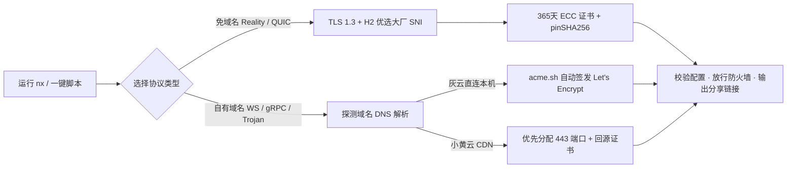

<div align="center">
  <a href="https://github.com/se-tang/NexusNode">
    
  </a>

  <h3>Zero-Panel · 纯 Shell 双核代理部署引擎</h3>
  <p>
    一条命令在 VPS 上部署 <strong>Xray-core</strong> 与 <strong>sing-box</strong> 主流抗封锁协议。<br/>
    自动探测域名与 Cloudflare CDN 状态、全自动签发证书、即拷即连。
  </p>

  <p>
    
    
    
    
  </p>

  <p>
    <a href="#快速开始">快速开始</a> ·
    <a href="#支持协议">支持协议</a> ·
    <a href="#智能部署流程">智能流程</a> ·
    <a href="#cloudflare-cdn-指南">CF CDN 指南</a> ·
    <a href="#项目结构">项目结构</a>
  </p>
</div>

---

## 快速开始

以 `root` 身份在 Linux VPS 上执行：

```bash
bash <(curl -fsSL https://raw.githubusercontent.com/se-tang/NexusNode/main/install.sh)
```

> [!TIP]
> 首次运行会自动安装到 `/opt/NexusNode` 并创建全局快捷指令 **`nx`**。<br/>
> 后续在终端任意位置输入 **`nx`** 即可再次打开面板；再次执行上方一键命令时，仅在远端仓库有更新时才自动同步。

<details>
<summary>预览交互界面</summary>

```text
==========================================
          NexusNode 智能代理部署工具
==========================================
 1. Xray-core (稳定成熟，抗封锁首选)
 2. sing-box  (新一代多协议，支持 Reality)
 3. 服务管理  (查看状态 / 日志 / 卸载)
 0. 退出脚本
------------------------------------------
 提示: 随时在终端输入 nx 可快速打开此面板
 请选择 [0-3]:
```

</details>

---

## 支持协议

* **Xray-core**：`VLESS-Reality` · `VLESS-XHTTP+Reality` · `VLESS-WS+TLS` · `VLESS-gRPC+TLS` · `Trojan`
* **sing-box**：`VLESS-Reality` · `Hysteria 2` · `TUIC v5` · `AnyTLS` · `Shadowsocks-2022` · `SOCKS5 / HTTP`

> 免域名推荐直接使用 **Reality / XHTTP / Hy2 / TUIC / AnyTLS**；使用自有域名时会自动识别灰云（`acme.sh` 签发正式证书）或 CF 小黄云（自动匹配 `443` 等 CDN 端口）。

---

## 智能部署流程



* **Zero-Panel 轻量化**：纯 Bash + `systemd` 托管，零面板常驻内存开销。
* **安全与环境兜底**：自动检查安装依赖、配置 pre-check 校验、自动放行 `ufw` / `firewalld` 端口，兼容 IPv4 与纯 IPv6 双栈。

---

## Cloudflare CDN 指南

<details>
<summary>点击展开：如何在 Cloudflare 上配合 Xray 3 / 4 使用优选 IP（零手动拷证书）</summary>

1. 在 Cloudflare `DNS` 添加一条 `A` 记录指向 VPS IP（首次申请证书时先保持**灰云**）。
2. 运行 `nx` → `1. Xray-core` → `3. VLESS - WS + TLS`（或 `4. gRPC`），输入域名，脚本会自动通过 `acme.sh` 申请并复用 Let's Encrypt 正式证书。
3. 确认 Cloudflare `SSL/TLS → 概述` 为 **`完全 (Full)`** 或 **`完全(严格)`**；若用 gRPC，在 `网络 (Network)` 开启 **`gRPC`**。
4. 在 Cloudflare 打开**小黄云**（推荐服务端使用 **`443`** 端口，兼容性最好），客户端可直接导入链接或将节点地址替换为 CF 优选 IP / 优选域名。

</details>

---

## 项目结构

```text
NexusNode/
├── install.sh        # 入口、版本比对更新、nx 快捷指令与服务管理
├── core/
│   ├── xray.sh       # Xray-core 部署模块 (Reality / XHTTP / WS / gRPC / Trojan)
│   └── singbox.sh    # sing-box 部署模块 (Reality / Hy2 / TUIC / AnyTLS / SS2022 / Mixed)
├── utils/
│   └── common.sh     # SNI 优选、域名 CDN 探测、acme.sh 自动签发、防火墙与 systemd 封装
└── assets/
    └── logo.svg
```

### 推荐客户端

* **全平台**：[v2rayN](https://github.com/2dust/v2rayN) · [Karing](https://github.com/KaringX/karing) · [Hiddify](https://github.com/hiddify/hiddify-app) · [Clash Verge Rev](https://github.com/clash-verge-rev/clash-verge-rev)
* **iOS / macOS**：Shadowrocket · Stash · Surge
