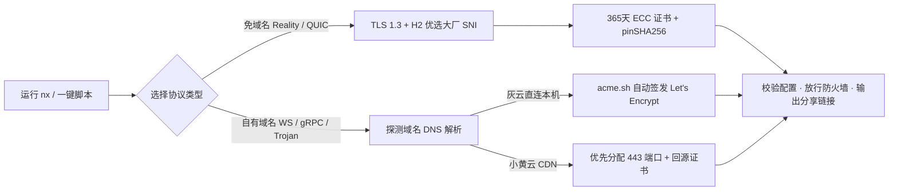

<div align="center">
  <a href="https://github.com/se-tang/NexusNode">
    
  </a>

  <h2>NexusNode</h2>
  <p>
    无面板 · 纯 Shell 双核代理部署引擎 — 一条命令在 VPS 上部署 <strong>Xray-core</strong> 与 <strong>sing-box</strong> 主流抗封锁协议。<br/>
    自动探测域名与 Cloudflare CDN 状态、全自动签发证书、即拷即连。
  </p>

  <p>
    
    
    
    
  </p>

  <p>
    <a href="#快速开始">快速开始</a> ·
    <a href="#支持协议">支持协议</a> ·
    <a href="#智能部署流程">智能流程</a> ·
    <a href="#cloudflare-cdn-指南">CF CDN 指南</a> ·
    <a href="#项目结构">项目结构</a>
  </p>
</div>

---

## 快速开始

以 root 身份在 Linux VPS 上执行：

```bash
bash <(curl -fsSL https://raw.githubusercontent.com/se-tang/NexusNode/main/install.sh)
```

> [!TIP]
> 首次运行会自动安装到 `/opt/NexusNode` 并注册全局快捷指令 **`nx`**。<br/>
> 之后随时输入 **`nx`** 即可呼出面板；再次执行一键命令时，仅在远端仓库有更新时才自动同步。

<details>
<summary>预览交互界面</summary>

```text
==========================================
          NexusNode 智能代理部署工具
==========================================
 1. Xray-core (稳定成熟，抗封锁首选)
 2. sing-box  (新一代多协议，支持 Reality)
 3. 服务管理  (查看状态 / 日志 / 卸载)
 0. 退出脚本
------------------------------------------
 提示: 随时在终端输入 nx 可快速打开此面板
 请选择 [0-3]:
```

</details>

---

## 支持协议

### Xray-core
- ✅ **VLESS - XTLS-Reality** — 免域名首选，借壳大厂 TLS 证书防主动探测
- ✅ **VLESS - XHTTP+Reality** — 新一代抗 DPI 传输层，免域名直连
- ✅ **VLESS - WS + TLS** — 支持 Cloudflare CDN 与优选 IP 中转
- ✅ **VLESS - gRPC + TLS** — 多路复用抗干扰（支持 CF CDN）
- ✅ **Trojan - gRPC / TLS** — gRPC 支持 CF CDN，TCP 限灰云直连

### sing-box
- ✅ **VLESS - XTLS-Reality** — sing-box 内核版 Reality 主力
- ✅ **Hysteria 2 (Hy2)** — 晚高峰 / 高丢包 QUIC 加速，自带 pinSHA256
- ✅ **TUIC v5** — 极致低延迟 QUIC 方案
- ✅ **AnyTLS** — 缓解传统 TLS-in-TLS 握手特征
- ✅ **Shadowsocks-2022** — 低 CPU 开销，适合中转与落地
- ✅ **SOCKS5 / HTTP** — 单端口双协议账号代理

> [!NOTE]
> **零域名推荐**：直接使用 Reality、XHTTP、Hy2、TUIC 或 AnyTLS。<br/>
> **自有域名**：自动探测灰云（acme.sh 签发正式证书）或 CF 小黄云（优先分配 443 端口）。

---

## 智能部署流程



- ✅ **无面板零驻留**：纯 Bash + systemd 托管，零常驻内存占用
- ✅ **自动环境兜底**：自动补齐缺失依赖、校验配置、放行 ufw / firewalld 端口
- ✅ **双栈全兼容**：自动识别 IPv4 与纯 IPv6 环境，直接输出标准客户端链接

---

## Cloudflare CDN 指南

> [!TIP]
> 配合 CF 小黄云使用 **Xray WS+TLS / gRPC+TLS**，只需在 CF 添加一条灰云 A 记录，无需手动拷贝证书。

<details>
<summary>点击展开：4 步完成配置与优选 IP</summary>

1. 在 Cloudflare 添加一条灰云 A 记录指向 VPS IP。
2. 运行 nx 选择 Xray 的 WS+TLS 或 gRPC+TLS，输入域名后脚本会自动申请证书（建议选 443 端口）。
3. 将 Cloudflare 的 SSL 模式设为 Full（或 Full Strict）；如用 gRPC，在网络设置中开启 gRPC。
4. 打开小黄云即可使用，客户端可将节点地址替换为 CF 优选 IP 或优选域名。

</details>

---

## 项目结构

```text
NexusNode/
├── install.sh        # 入口、版本比对更新、nx 快捷指令与服务管理
├── core/
│   ├── xray.sh       # Xray-core 部署模块
│   └── singbox.sh    # sing-box 部署模块
├── utils/
│   └── common.sh     # SNI 优选、域名探测、acme.sh 签发、防火墙与 systemd 封装
└── assets/
    └── logo.svg
```

### 推荐客户端

* **全平台**：[v2rayN](https://github.com/2dust/v2rayN) · [Karing](https://github.com/KaringX/karing) · [Hiddify](https://github.com/hiddify/hiddify-app) · [Clash Verge Rev](https://github.com/clash-verge-rev/clash-verge-rev)
* **iOS / macOS**：Shadowrocket · Stash · Surge
